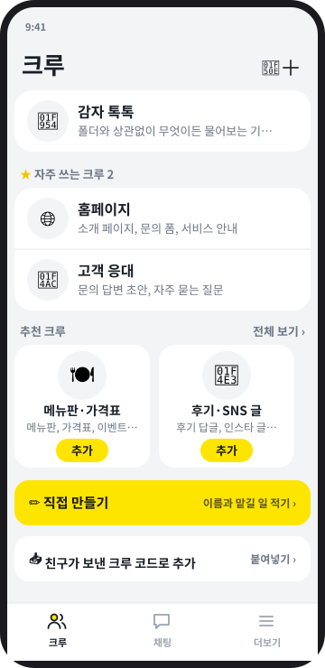
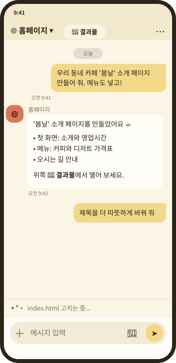
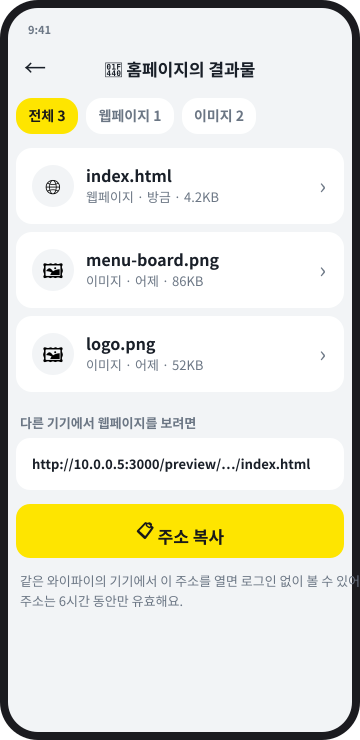
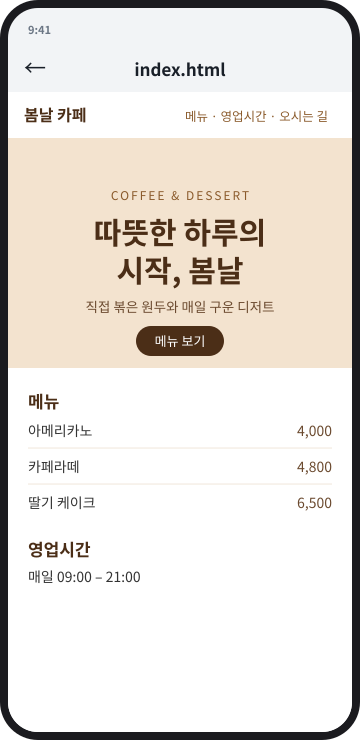
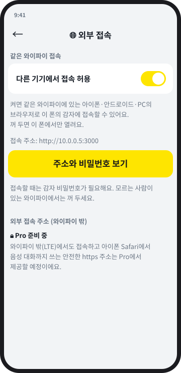

# 감자 (GAMJA)

**말하면 만들어 주는, 내 폰 속 AI 크루.**
쓰던 안드로이드 폰 한 대에 나만의 [Claude Code](https://claude.com/claude-code) 크루를 두고, 메신저처럼 말을 걸어서
홈페이지, 문서, 그림, 일정 같은 걸 만들어 보세요. 맥미니도, 클라우드 서버도 필요 없어요.

[홈페이지](https://webgamja.com) · [English README](README.md) · [내려받기](https://github.com/webgamja/gamja-release/releases/latest) ·
[참여하기](CONTRIBUTING.md) · [보안](SECURITY.md) · [라이선스: Apache-2.0](LICENSE)

<p>
  <a href="https://raw.githubusercontent.com/webgamja/gamja/main/docs/img/01-crews.svg"></a>
  <a href="https://raw.githubusercontent.com/webgamja/gamja/main/docs/img/02-chat.svg"></a>
  <a href="https://raw.githubusercontent.com/webgamja/gamja/main/docs/img/03-result.svg"></a>
  <a href="https://raw.githubusercontent.com/webgamja/gamja/main/docs/img/05-view.svg"></a>
  <a href="https://raw.githubusercontent.com/webgamja/gamja/main/docs/img/04-access.svg"></a>
</p>

<sub>화면은 실제 앱 디자인을 따라 그린 예시예요. 실제 캡처로 바꿀 예정이에요.</sub>

**믿을 수 있는 이유**
- 대화와 파일은 **내 폰에만** 있어요. 감자 운영자는 수집하지도, 볼 수도 없어요.
- 코드가 **오픈소스**(Apache-2.0)라서 누구나 무엇을 하는지 확인할 수 있어요.
- 로그인은 Anthropic의 공식 화면에서 **내 Claude 계정**으로 해요. 감자는 로그인 정보를 보지 않아요.

> **상태: 초기 버전 (v0.x).** 감자는 아직 어리고 빠르게 바뀌어요. 스스로 업데이트하고, 새 버전이 계속 죽으면 자동으로
> 이전 버전으로 돌아가지만, 거친 부분이 있을 수 있어요. 감자는 **Anthropic과 관련 없는 독립 프로젝트**예요.
> 본인의 Claude 구독이 필요하고, 감자는 Claude를 대신 팔지 않아요.

## 무엇을 하나요

- **크루**: 일마다 따로 일하는 AI 팀원이에요. 각 크루는 자기 프로젝트 폴더와 지침(`CLAUDE.md`)을 가져요. 홈페이지, 고객 응대 글,
  일정 정리 같은 추천 크루를 고르거나 직접 만들 수 있어요.
- **메신저처럼 대화**: 크루 목록, 채팅 목록, 크루와의 채팅방, 안 읽은 표시, 일이 끝났을 때 알림. 말로 시키고 답을 들을 수도 있어요.
- **결과물 화면**: 크루가 만든 웹페이지, 이미지, 문서, 음악, 영상을 앱 기능과 분리된 안전한 화면에서 열어 봐요.
- **도구 상자**: 문서·그림 도구는 알아서 설치돼서 크루가 워드·PDF·엑셀, PNG 그림을 바로 만들어요. 영상처럼 다른 도구가 필요하면
  크루가 "설치하고 이어서 하기" 카드로 물어봐요.
- **내가 정해요**: 크루가 아직 허용되지 않은 명령이 필요하면 카드로 물어봐요. 이번만 허용, 항상 허용, 허용 안 함 중에 고르고,
  위험한 명령은 어떤 경우에도 허용할 수 없어요. 허용한 목록은 더보기 → 허용한 명령에서 확인해요.
- **다른 기기에서도**: 같은 와이파이 접속을 켜면 아이폰·다른 안드로이드·PC에서 주소를 열거나 QR 코드를 찍어 접속해요.
  크루 이름, 고정, 읽음 표시는 모든 기기가 같이 써요.
- **내 폰에서 실행**: 앱이 폰 안에 작은 우분투(proot)와 Node.js, Claude Code를 준비해요. 대화와 파일은 내 폰에 있어요.
- **스스로 업데이트, 안전장치**: 새 버전이 자동으로 오고, 새 코드는 문법 검사와 시험 실행을 통과해야 바뀌어요. 새 버전이 계속
  죽으면 마지막으로 잘 돌던 버전으로 자동 복구해요.
- **한국어·영어** 화면.

## 필요한 것

- 충전기에 꽂아 둘 수 있는 안드로이드 폰(안드로이드 8 이상). 쓰던 폰이면 충분해요.
- 내 **Claude 구독**
- 처음 한 번 10~20분의 준비 시간(와이파이 연결 상태)

## 설치

1. [최신 릴리스](https://github.com/webgamja/gamja-release/releases/latest)에서 `gamja.apk`를 받아 설치해요
   (안드로이드 8 이상, "출처를 알 수 없는 앱 설치"를 허용해야 해요).
2. 감자를 열면 처음 한 번 준비를 해요. 10~20분 걸리니 와이파이와 충전기를 연결해 두세요.
3. 공식 Claude Code 화면에서 **내 Claude 계정**으로 로그인해요. 감자는 로그인 정보를 보지 않아요.
4. 안드로이드 설정에서 감자의 배터리 사용을 "제한 없음"으로 바꿔요.
5. 크루를 고르고 하고 싶은 일을 말해 보세요.

감자는 구글 플레이가 아니라 GitHub에서 배포해요. 이유는 [android/README.md](android/README.md)를 보세요.

## 다른 기기에서 접속

폰의 감자 → 더보기 → 연결 → **외부 접속**에서 "다른 기기에서 접속 허용"을 켜면(기본은 꺼짐) **같은 와이파이**의
아이폰·다른 안드로이드·PC가 브라우저로 접속할 수 있어요. 앱 안에서는 "주소와 비밀번호 보기"로 주소와 비밀번호를 확인해요.
와이파이 밖(LTE)에서도 접속하는 주소는 GAMJA Pro에서 제공할 예정이에요.
**감자는 로그인한 사람이 그 폰의 파일을 읽고 고칠 수 있는 도구예요.** 비밀번호를 길게 정하고, 모르는 사람이 있는 와이파이에서는
꺼 두세요. 자세한 내용은 [SECURITY.md](SECURITY.md)에 있어요.

GAMJA Free는 내 폰에서 도는 모든 기능이에요. 우리 서버가 필요한 기능은 GAMJA Pro로 준비하고 있어요.

## 자주 묻는 질문

- **무료인가요?** 네. 감자는 무료 오픈소스예요. 내 Claude 구독료만 따로 내요.
- **내 데이터는 어디에 있나요?** 내 폰에 있어요. 보낸 메시지는 Claude(Anthropic)가 그쪽 약관에 따라 처리해요.
- **아이폰에서도 되나요?** 앱은 안드로이드용이에요. 아이폰은 같은 와이파이에서 브라우저로 접속할 수 있어요.
- **왜 구글 플레이에 없나요?** [android/README.md](android/README.md)를 보세요.
- **Anthropic에서 만든 건가요?** 아니에요. 감자는 독립 프로젝트예요.

## 내 컴퓨터에서 감자알(서버) 실행하기

Node.js 18 이상과, 로그인된 `claude` 명령이 필요해요.

```bash
cp .env.example .env      # APP_PASSWORD를 꼭 바꾸세요
mkdir -p ~/projects       # 안의 폴더 하나가 크루 하나예요
./start.sh                # tmux 세션에서 실행, 비정상 종료되면 3초 뒤 자동 재시작
```

`http://localhost:3000`으로 접속해요.

| 명령 | 동작 |
|---|---|
| `./start.sh` | 시작 (이미 실행 중이면 안내만) |
| `./start.sh restart` | 재시작 |
| `./start.sh stop` | 종료 |
| `./start.sh attach` | 로그 보기 (빠져나오기: `Ctrl+b` 다음 `d`) |

### 환경변수 (`.env`)

| 변수 | 기본값 | 설명 |
|---|---|---|
| `APP_PASSWORD` | (필수) | 로그인 비밀번호. 바꾸면 기존 로그인은 모두 풀려요 |
| `PORT` / `HOST` | `3000` / `0.0.0.0` | 접속 위치 |
| `PROJECTS_DIR` | `~/projects` | 크루(하위 폴더)들이 있는 폴더 |
| `CLAUDE_BIN` | `claude` | claude 실행 파일 경로 |
| `ALLOWED_TOOLS` | (없음) | 추가로 자동 허용할 도구. 예: `"Bash(git status:*) Bash(npm test:*)"` |
| `DATA_DIR` | `./data` | 대화 기록 저장 폴더 |
| `SESSION_DAYS` | `30` | 로그인 유지 기간 |
| `COOKIE_SECURE` | (없음) | HTTPS 프록시 뒤에서 `1` |

### Termux로 직접 설치 (고급)

새 폰에 Termux를 설치한 뒤 `bash scripts/install.sh`를 실행하면 Ubuntu(proot), Node.js, Claude Code, 감자알을 차례로
설치해요. 다시 실행하면 코드만 업데이트되고 대화 기록과 `.env`는 유지돼요. 관리 명령은 `gamja start | stop | restart | status | logs | login | shell`이에요.

## 권한

`acceptEdits` 모드는 **파일 읽기와 편집만 자동 승인**해요. 비대화형(`-p`) 모드에서는 승인 창을 띄울 수 없어서, 나머지 도구(Bash 명령 등)는
허용하지 않으면 거부돼요. 이때 답변 아래에 `권한이 거부된 도구: ...`가 보여요. 자주 쓰는 명령은 `ALLOWED_TOOLS`에 넣거나 크루 폴더의
`.claude/settings.json`에서 `permissions.allow`로 허용하세요. `"Bash"`처럼 통째로 허용하면 아무 명령이나 실행되므로 권하지 않아요.

## 동작 방식

```
브라우저/앱 ──POST /api/chat {message, project}──▶ server.js
           ◀──────── text/event-stream (SSE) ────────  │
                                                        └─ spawn: claude -p --output-format stream-json --verbose
                                                                  --include-partial-messages --permission-mode acceptEdits
                                                                  [--resume <session_id>]   (cwd = 크루 폴더)
```

- 대화 기록과 세션 ID는 `data/conversations/`에 저장돼요(방마다 최근 500개). Claude의 실제 맥락은 Claude Code가 저장한 세션을
  `--resume`으로 이어가요.
- 답변은 서버가 직접 모아 저장하므로 화면이 꺼져 연결이 끊겨도 기록에 남고, 돌아오면 이어서 보여 줘요.
- 한 방에서는 응답을 하나씩만 실행해요.
- 채팅으로 코드를 고치고 재시작하는 흐름: Claude가 코드를 고친 뒤 `data/restart-request` 파일을 만들면, 답변이 끝난 뒤 새 코드를 문법 검사와
  임시 포트 시험 실행으로 확인하고, 통과하면 재시작해요. 실패하면 이전 코드로 계속 돌아요. 30초 넘게 잘 돈 코드는 `data/versions/`에
  안정 버전으로 저장되고, 새 코드가 시작하자마자 3번 연속 죽으면 `start.sh`가 마지막 안정 버전으로 자동 복구해요.
  비상 화면 `/safe.html`은 평소 화면이 망가져도 되돌리기와 재시작을 할 수 있는 단독 페이지예요.

## 안드로이드 앱 만들기

main에 올리면 GitHub Actions(`.github/workflows/android.yml`)가 APK를 만들어요. 직접 빌드하려면 `android/`를 Android Studio로
열거나 Gradle을 쓰세요. proot는 `android/scripts/fetch-proot.sh`가 받고, 서버 묶음은 `android/scripts/bundle-egg.sh`가 만들어요.
직접 만든 앱을 배포할 때는 앱 이름, 패키지 이름, 서명 키를 바꿔 주세요([TRADEMARK.md](TRADEMARK.md)).

## 파일 구조

```
server.js        감자알(서버): 인증, claude 실행, SSE, 크루·대화 저장
public/          화면 (index.html, app.js, style.css, i18n.js, templates.js ...)
tools/           gamja-make: 크루가 문서·그림·영상·소리를 만들 때 쓰는 도구
android/         안드로이드 앱(Kotlin)과 빌드 스크립트
scripts/         Termux / Ubuntu 설치 스크립트
start.sh         tmux 실행·감시 루프, 자동 복구
```

## 참여하기

버그 제보, 아이디어, 번역, 코드 모두 환영해요. [CONTRIBUTING.md](CONTRIBUTING.md)를 읽어 주세요. 커밋에는
[DCO](https://developercertificate.org/) 서명(`git commit -s`)을 붙여요.

## 라이선스

코드는 [Apache License 2.0](LICENSE)이에요. 함께 쓰는 오픈소스는 [NOTICE](NOTICE)에 적었어요. "GAMJA", "감자"라는 이름과 로고는
[상표 안내](TRADEMARK.md)를 따라 주세요.

문의: help@webgamja.com
