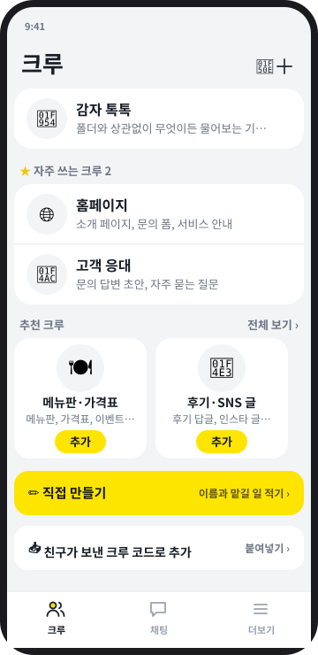
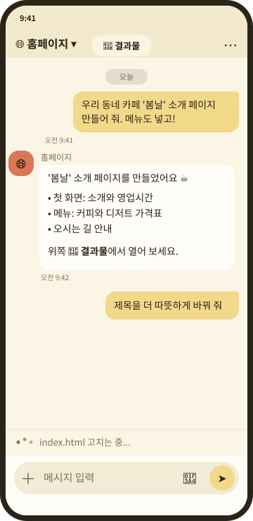
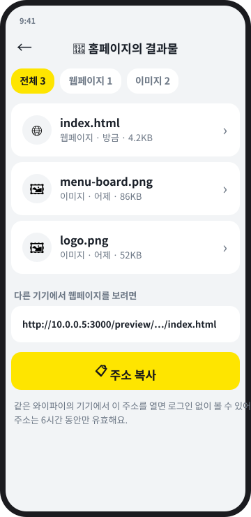
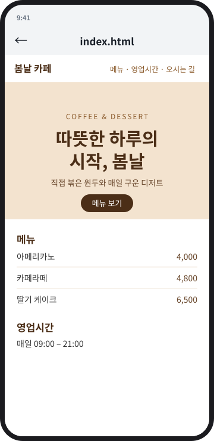
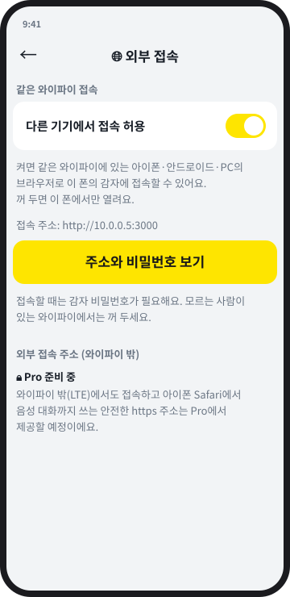

# GAMJA (감자)

**Your own AI crew, living in your phone.**
Turn a spare Android phone into a home for your own [Claude Code](https://claude.com/claude-code) crews, and talk to
them from a chat app: websites, documents, images, schedules and more. No Mac mini, no cloud server.

[Website](https://webgamja.com/en/) · [한국어 README](README.ko.md) · [Download](https://github.com/webgamja/gamja-release/releases/latest) ·
[Contributing](CONTRIBUTING.md) · [Security](SECURITY.md) · [License: Apache-2.0](LICENSE)

<p>
  
  
  
  
  
</p>

<sub>Screens are illustrations drawn from the real app design; real screenshots will replace them.</sub>

**Why you can trust it**
- Your conversations and files **stay on your own phone**. The GAMJA operator does not collect or see them.
- The code is **open source** (Apache-2.0), so anyone can check what it does.
- You sign in on Anthropic's official screen with **your own Claude account**. GAMJA never sees your login.

> **Status: early (v0.x).** GAMJA is young and changes quickly. It updates itself, and a broken update rolls back
> automatically, but please expect rough edges. GAMJA is an independent project and is **not affiliated with
> Anthropic**. You need your own Claude subscription; GAMJA does not sell or resell Claude.

## What it does

- **Crews**: each crew is an AI teammate with its own project folder and instructions (a `CLAUDE.md` file), such as a
  homepage maker, a customer-reply writer or a daily planner. Pick one from the recommended list or create your own.
- **Chat like a messenger**: a crew list, a chat list, chat rooms with your crews, unread badges and notifications
  when a job is finished. Talk by voice and listen to the answers.
- **Results screen**: web pages, images, documents, music and video that a crew made open in a separate, sandboxed
  screen.
- **Toolbox**: install document, image and media tools with one tap, so crews can make Word/PDF/Excel files,
  PNG images and slideshow videos.
- **Runs on your phone**: the app sets up a small Ubuntu environment (using proot) with Node.js and Claude Code.
  Your conversations and files stay on your phone.
- **Self-updating and safe**: new versions arrive automatically, new code is syntax-checked and test-started before
  it replaces the old one, and the last stable version is restored automatically if the new one keeps crashing.
- **Two languages**: Korean and English.

## What you need

- An Android phone (Android 8 or newer) that you can leave plugged in. A spare phone works well.
- Your own **Claude subscription**.
- About 10 to 20 minutes for the first start (one time, on Wi-Fi).

## Install

1. Download `gamja.apk` from the [latest release](https://github.com/webgamja/gamja-release/releases/latest)
   and install it (Android 8 or newer). Allow "install unknown apps" for your browser when asked.
2. Open GAMJA. The first start prepares everything and takes 10 to 20 minutes. Keep it on Wi-Fi and plugged in.
3. Sign in with **your own Claude account** on the official Claude Code screen. GAMJA never sees your login.
4. In Android settings, set the battery usage of GAMJA to "Unrestricted" so it can keep running.
5. Pick a crew and say what you want.

GAMJA is distributed from GitHub, not from Google Play. See
[android/README.md](android/README.md) for why (it runs programs inside the app, which Android 10+ restricts for
apps that target newer Android versions).

## Open it from another device

On the phone: **More → Connect → External access**. Turn on "Allow access from other devices" (it is off by default)
and an iPhone, another Android phone or a PC on the **same Wi-Fi** can open the address in a browser. You need the
GAMJA password. An address that works outside Wi-Fi (mobile data) is planned for GAMJA Pro.

GAMJA Free is everything that runs on your own phone. Features that need our own servers will come in GAMJA Pro.

## FAQ

- **Is it free?** Yes. GAMJA is free and open source. You pay for your own Claude subscription.
- **Where is my data?** On your phone. Messages you send are processed by Claude (Anthropic) under Anthropic's terms.
- **Does it work on iPhone?** The app runs on Android. An iPhone can open it in a browser over the same Wi-Fi.
- **Why not Google Play?** See [android/README.md](android/README.md).
- **Is it from Anthropic?** No. GAMJA is an independent project.

## How it works

```
Phone (Android app)                                   Claude Code
┌──────────────────────────────────────────┐        ┌───────────────┐
│ GAMJA app (Kotlin)                        │        │ claude -p ... │
│  ├─ foreground service                    │        └──────▲────────┘
│  ├─ proot + Ubuntu                        │               │ spawn (cwd = crew folder)
│  │    └─ gamja-egg (server.js, Node.js) ──┼───────────────┘
│  └─ WebView ──► http://127.0.0.1:3000 ◄───┘  chat UI (public/), streamed with SSE
└──────────────────────────────────────────┘
```

- `server.js` ("gamja-egg") is a small Node.js server with **no npm dependencies**. For every message it starts
  `claude -p --output-format stream-json` in the crew's folder and streams the answer to the web screen.
- The web screens in `public/` are plain HTML, CSS and JavaScript.
- Permission mode is `acceptEdits`: files can be read and edited automatically; other tools such as shell commands
  are denied unless you allow them.

## Run the server on your computer

You need Node.js 18+ and the `claude` command line tool, already signed in.

```bash
cp .env.example .env      # set APP_PASSWORD
mkdir -p ~/projects       # each folder inside is a crew
./start.sh                # runs in a tmux session, restarts after crashes
```

Open `http://localhost:3000`. Main settings (`.env`):

| Variable | Default | Meaning |
|---|---|---|
| `APP_PASSWORD` | (required) | Login password |
| `PORT` / `HOST` | `3000` / `0.0.0.0` | Where to listen |
| `PROJECTS_DIR` | `~/projects` | Folder whose sub-folders are crews |
| `CLAUDE_BIN` | `claude` | Path to the Claude Code executable |
| `ALLOWED_TOOLS` | (none) | Extra tools to allow, e.g. `"Bash(git status:*)"` |
| `DATA_DIR` | `./data` | Where chat history is stored |
| `COOKIE_SECURE` | (none) | Set to `1` behind an HTTPS proxy |

**Security note**: GAMJA lets whoever logs in read and change files on the machine it runs on. Use a long
password and do not expose the port to the public internet; use the same Wi-Fi, a VPN or a private tunnel.
See [SECURITY.md](SECURITY.md).

## Build the Android app

GitHub Actions builds the APK on every push to `main` (`.github/workflows/android.yml`). To build it yourself,
open `android/` with Android Studio or run Gradle. The proot binaries are fetched by
`android/scripts/fetch-proot.sh`, and the server bundle is made by `android/scripts/bundle-egg.sh`.
If you distribute your own build, change the app name, the package id and the signing key
(see [TRADEMARK.md](TRADEMARK.md)).

## Project layout

```
server.js        the gamja-egg server (auth, running claude, SSE, project and chat storage)
public/          web screens (index.html, app.js, style.css, i18n.js, templates.js, ...)
tools/           gamja-make: a helper crews use to make documents, images, video and sound
android/         the Android app (Kotlin) and its build scripts
scripts/         Termux / Ubuntu install scripts
start.sh         tmux supervisor with automatic rollback
```

## Contributing

Bug reports, ideas, translations and pull requests are welcome. Please read [CONTRIBUTING.md](CONTRIBUTING.md);
commits are signed off with the [DCO](https://developercertificate.org/) (`git commit -s`).

## License

Code: [Apache License 2.0](LICENSE). Third-party components are listed in [NOTICE](NOTICE). The names
"GAMJA" and "감자" and the logo are covered by the [trademark policy](TRADEMARK.md).

Contact: help@webgamja.com
